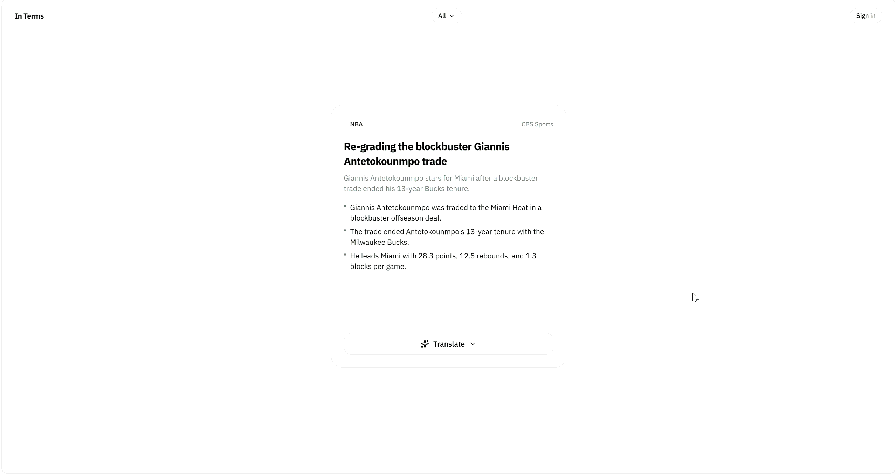
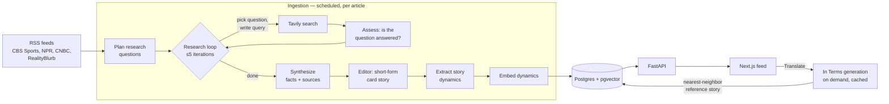

# In Terms

**News explained in the language of what you already follow.** In Terms is a
swipeable news feed where any story can be retold "in terms of" a domain you
care about — a Senate vote framed the way an NBA writer would cover it, an
NFL injury framed like a reality-TV elimination — without changing a single
fact.

**[Live app](https://in-terms.vercel.app) · [2-min demo](https://www.loom.com/share/5f23408273384ddd8025a7b93cda3b9d)**

<!-- Record a ~5s GIF of hitting Translate on a card and save it here -->


**Results at a glance**

- The rebuilt generator beat v1 **30–6 in blind human review** on 40 held-out
  articles (p < 0.001, sign test).
- LLM-judged on the same set: cards that were mostly a vocabulary swap fell
  from 90% → 2%, and fact faithfulness rose from 60% → 85%.
- Runs in production for **≈ $0.06 per article** and single-digit dollars a
  month, with a daily spend cap and a fail-closed sensitive-story filter.

## How it works



1. **Research agent.** Each RSS item seeds a plan of 3–6 research questions.
   The agent loops: choose the most important unanswered question, write one
   search query, assess whether the evidence now answers it. It stops when
   every question is answered or after 5 searches, rejecting repeat queries.
2. **Editor.** Research is condensed into a card-sized story (headline,
   summary, key points) using only researched evidence.
3. **Dynamics.** Each story is classified into an abstract "shape" — power
   shifts, setbacks, rivalries, emotional beats — and that classification is
   embedded.
4. **In Terms.** When a reader hits Translate, the backend retrieves the 5
   most structurally similar stories *in the target domain* from the last 90
   days (pgvector cosine distance over dynamics embeddings, sensitive stories
   excluded). The model picks the one that genuinely mirrors the original, or
   none, and explains the original by comparison: "X is like Y: <shared
   shape>". The card shows which real story it was compared with. Facts about
   each story come only from that story. Results are cached per
   (article, target).

### Key design decisions

- **Embed the dynamics, not the text.** Embedding raw text would match an NBA
  injury to other NBA injuries. Embedding the abstract dynamics lets a sudden
  NFL injury match a reality-TV contestant's surprise exit — the
  cross-domain analogy is the whole product.
- **Structured output everywhere.** Every LLM step returns a Pydantic schema
  (`ResearchPlan`, `FinalStory`, `InTermsResult`, …), so failures are parse
  errors at a known step rather than malformed text downstream.
- **Generate In Terms lazily.** 6 categories means 5 possible translations
  per article; generating on first request and caching avoids paying for
  combinations nobody reads.
- **Let the model choose (or refuse) the parallel.** Retrieval over coarse
  dynamics labels is rough: in evals the model picked something other than
  the nearest neighbor about half the time, and declined to compare at all
  when nothing fit, because a forced comparison is worse than none.

## Evaluation

The product's promise — *reframe without changing facts* — is measured, not
assumed.

### Comparison vs. keyword swap (A/B)

The first version of In Terms used the retrieved story only "for tone", and
in practice it swapped target-domain vocabulary into the original ("the
Warriors' *legislative package*"). `evals/compare_eval.py` A/B tests the
current generator against a frozen copy of that one
(`evals/baseline_in_terms.py`) on the same articles, at the same time. The
judge compares the two cards blind in both orders, since LLM judges favor
whichever they read first, and a win counts only if it's order-consistent.
The prompt was tuned on a 40-item dev set. The numbers below are from a
**held-out** set of 40 articles that weren't in the dev set:

| | Old (tone only) | New (comparison) | p |
|---|---|---|---|
| **Human head-to-head (blind)** | 6 wins | **30 wins** (4 ties) | <0.001 (sign test) |
| Judge head-to-head | 2 wins | **36 wins** (2 ties) | <0.001 (sign test) |
| Faithful (LLM judge) | 60% | **85%** | 0.05 (McNemar) |
| Mostly a vocabulary swap (LLM judge) | 90% | **2%** | <0.001 |
| Names a real parallel (LLM judge) | 0% | 52% (abstains otherwise) | <0.001 |
| Parallel genuinely holds (LLM judge) | 0% | 8% | 0.25 |

I labeled the held-out pairs blind myself, and the judge agreed with my
pick on 28/40.

What this showed:

- **The comparison format clearly beats vocabulary swapping,** and it's more
  faithful, because comparing ("is like") doesn't tempt the model to relabel
  real entities.
- **The bottleneck is now the corpus, not the prompt.** The judge rates most
  chosen parallels as loose (Red Sox pitching depth ≈ a venue company's
  expansion). Showing the model 20 candidates instead of 5 didn't help (10%
  hold, dev set), so better ranking isn't the fix: with ~40 stories per
  category, a true structural twin often doesn't exist yet. It should improve
  as ingestion accumulates stories.
- **When no stored story fits, the fallback holds up.** The model compares
  to a familiar *kind* of event instead ("a temporary $15k/month payout is
  like a government stopgap funding bill"). In blind labeling I preferred
  the new card 15–2 in those cases, the same as when it used a stored
  story (15–4). Most of the new version's losses were stored parallels
  that were a stretch (a hamstring return ≈ voters reaching flooded polls).

### Single-output checks

`evals/in_terms_eval.py` scores individual In Terms cards on:

- **Format** (code-checked): card length limits.
- **Faithful** (LLM judge + human labels): no invented, changed, or
  relabeled facts or entities.
- **Domain-specific** (LLM judge + human labels): uses a named trope of the
  target domain, not generic "drama".

The judge (`gemini-3.8-flash`) is deliberately a stronger, pinned model than
the generator. Judge scores are directional until it's calibrated against
hand labels: early spot checks suggested the single "faithful" criterion
conflates *are the facts correct?* with *are real entities renamed into
target-domain terms?*, so it's being split into two criteria first.

Failure patterns these checks surfaced:

- **The dominant failure is relabeling** — stating a target-domain term as
  fact ("a five-year *max extension*" for a corporate contract; "no relief"
  for "little relief"), exactly the failure the prompt forbids.
- **Technical-vocabulary domains fail most.** Finance/Business/Politics
  targets substitute jargon for real figures ("37.4% offensive *liquidity*
  rate").
- **Upstream contamination.** One source story contained an unrelated fact
  pulled from a search result, so the base editor needs a faithfulness check
  too.

## Reliability

- Sensitive stories (sexual violence, abuse, death, war, terrorism, suicide,
  addiction, violent crime) can't be translated. Before this existed, a
  sexual-assault conviction was framed as an NFL "playoff blowout" and a
  planned military strike as an MLB "opening series". The editor classifies
  each story in the same call that writes it, so it costs no extra LLM call.
  An LLM rather than a keyword list, because keywords flagged "Warriors" and
  "strikeouts" but missed "Milania Giudice under professional care".
  Unclassified stories are blocked, i.e. it fails closed.
- An article whose research doesn't cover the story is deferred, not saved:
  the synthesizer flags evidence that's empty or off-topic (`on_topic`), and
  the editor is never called. This came from production: a story ingested
  ~2h after publishing found no coverage yet and became a "No Information
  Available" card, and another became a card about the publisher's website.
  Deferred articles retry on the next run and count toward the cost cap.
- The feed is public (sign-in only adds personalization), so anyone can
  trigger In Terms generation. Spend is bounded by a daily cap on *new*
  generations (`MAX_IN_TERMS_GENERATIONS_PER_DAY`, default 200): cached
  translations are always served, and past the cap a cache miss returns 429
  instead of calling the model. Worst-case daily spend is the cap times the
  per-generation cost, whoever is calling.
- Malformed feed entries are skipped and logged, a failing feed doesn't stop
  the others, and a failed article rolls back its DB session so the rest of
  the run continues.
- A feed whose newest entry is >72h old logs a stale-feed warning. (The
  original WSJ business feed had stopped publishing in January 2025 and
  nothing flagged it until this check existed.)
- In Terms logs a warning when no reference story exists in the similarity
  window.
- All model calls use the async client, so one slow generation doesn't block
  other API requests.

## Measured cost and latency

Measured on live articles with `scripts/measure_pipeline.py` (n=3, Nov 2026,
Gemini 3.5 Flash-Lite at $0.30/$2.50 per M tokens, Tavily at $0.008/search):

| Per ingested article | |
|---|---|
| LLM calls | 14 |
| Web searches | 5 |
| Input / output tokens | ~57k / ~1.7k |
| Wall time | ~26 s (sequential) |
| **Cost** | **≈ $0.06** — 65% search, 35% LLM |

Where it goes, and what that suggests:

- **Every article hit the 5-search cap.** The agent never decided it was
  done, so the cap — not the agent — sets cost. Production now caps research
  at 2 searches and ingestion at 2 new articles per feed per day, which keeps
  search inside Tavily's free tier and total spend to single-digit dollars a
  month. A smarter stop criterion is the next lever.
- **84% of input tokens are two steps** (`ResearchQuestionAssessment` 30k,
  `ResearchDecision` 17.5k), because each loop iteration re-sends all
  evidence gathered so far — token use grows quadratically with searches.
  Passing only new evidence to the assessor would cut most of it.
- **Search is ~43% of wall time** and runs sequentially.

Every LLM/search call is metered (`services/usage.py`), so each ingested
article and each In Terms generation logs its own calls, tokens, latency, and
cost.

## Deployment

| Piece | Where |
|---|---|
| Frontend | Vercel |
| API | Render (Docker) |
| Database | Neon (Postgres + pgvector) |
| Ingestion | GitHub Actions, daily cron (`.github/workflows/ingest.yml`) |
| Tests | GitHub Actions on every push, against a throwaway pgvector container (`.github/workflows/tests.yml`) |

Ingestion runs as a scheduled job rather than an always-on worker: it does
one pass and exits, so it costs nothing between runs. A run that hits any
feed or article failure exits non-zero, which marks it failed and triggers
GitHub's email notification — that's the alerting.

The API runs on Render's free tier, which spins down after ~15 idle minutes
and took 30–60 s to cold-start on a visitor's first load. An external uptime
monitor pings `/health` every 10 minutes to keep it warm. That endpoint
skips the database, so Neon still auto-suspends (and wakes in about a second)
instead of burning compute hours on pings.

## Stack

**Backend:** Python 3.14, FastAPI, SQLAlchemy, Alembic, Postgres + pgvector
(Neon), Gemini (generation + embeddings), Tavily (search), APScheduler.
**Frontend:** Next.js 16, React 19, Tailwind 4, shadcn/ui, Better Auth
(Google sign-in).

## Running locally

```bash
# Database (or point DATABASE_URL at any pgvector-enabled Postgres)
docker compose up -d

# Backend
cd backend
cp .env.example .env            # add GOOGLE_API_KEY and TAVILY_API_KEY
uv sync
uv run alembic upgrade head
uv run fastapi dev              # API on :8000
uv run python scheduler.py --once   # one ingestion pass (what CI runs daily)
uv run python scheduler.py      # or: keep running, every INGESTION_INTERVAL_MINUTES
uv run pytest tests/unit        # no DB, network, or keys needed

# Frontend
cd frontend
npm install
npm run dev                     # needs API_BASE_URL, DB_URL, Better Auth
                                # secret/URL, GOOGLE_CLIENT, GOOGLE_CLIENT_SECRET
```

Measurement and evals (these make real API calls):

```bash
cd backend
uv run python -m scripts.measure_pipeline --count 3
uv run python -m evals.compare_eval  ...   # A/B vs. baseline; `label` and `report` subcommands
uv run python -m evals.in_terms_eval export --fresh 20 --out evals/data/run.jsonl
uv run python -m evals.in_terms_eval label  evals/data/run.jsonl
uv run python -m evals.in_terms_eval judge  evals/data/run.jsonl
uv run python -m evals.in_terms_eval report evals/data/run.jsonl
```

## Known limitations and next steps

- **Grow the comparison pool.** Only ~8% of parallels genuinely hold with
  ~40 stories per category. More stories per feed, or embedding a free-text
  "shape" sentence instead of the labels, are the next levers, and
  `compare_eval.py` is the check.
- **Calibrate the judge.** Split "faithful" into *facts correct* and *no
  relabeled entities*, then validate each against hand labels before
  trusting single-output judge scores.
- Enforce card length limits in code (truncate or retry) instead of relying
  on the prompt.
- Cut research cost: a stricter stop condition and incremental evidence in
  the loop.
- Database calls are synchronous inside async routes; fine at current load,
  but they'd move to an async driver under real traffic.
- The feed loads the newest 100 articles and filters client-side; per-category
  server-side queries and pagination are needed past that.
